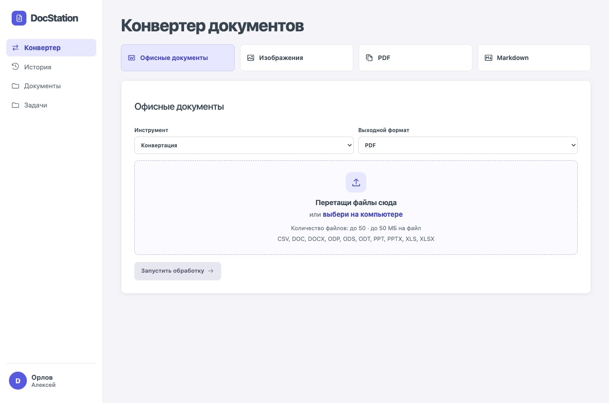
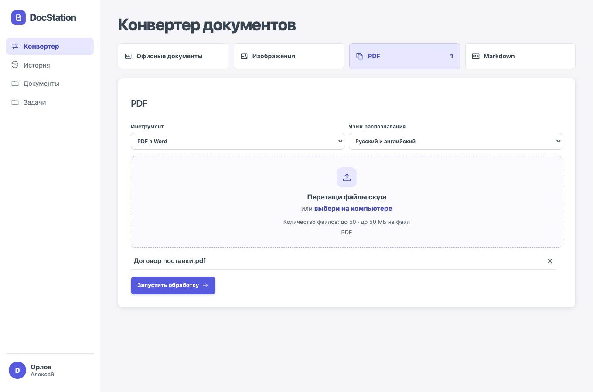
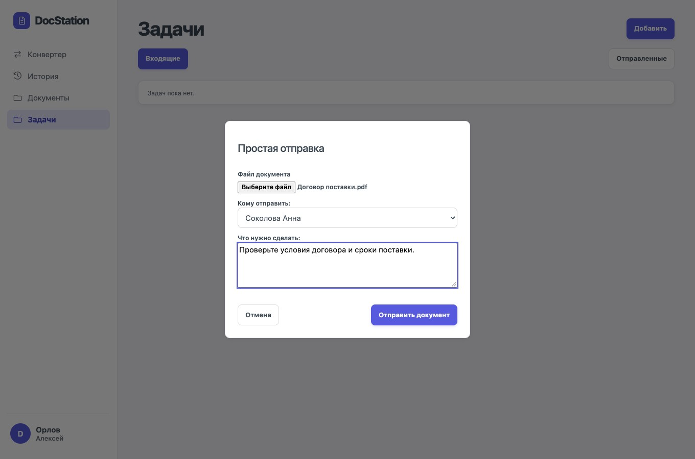
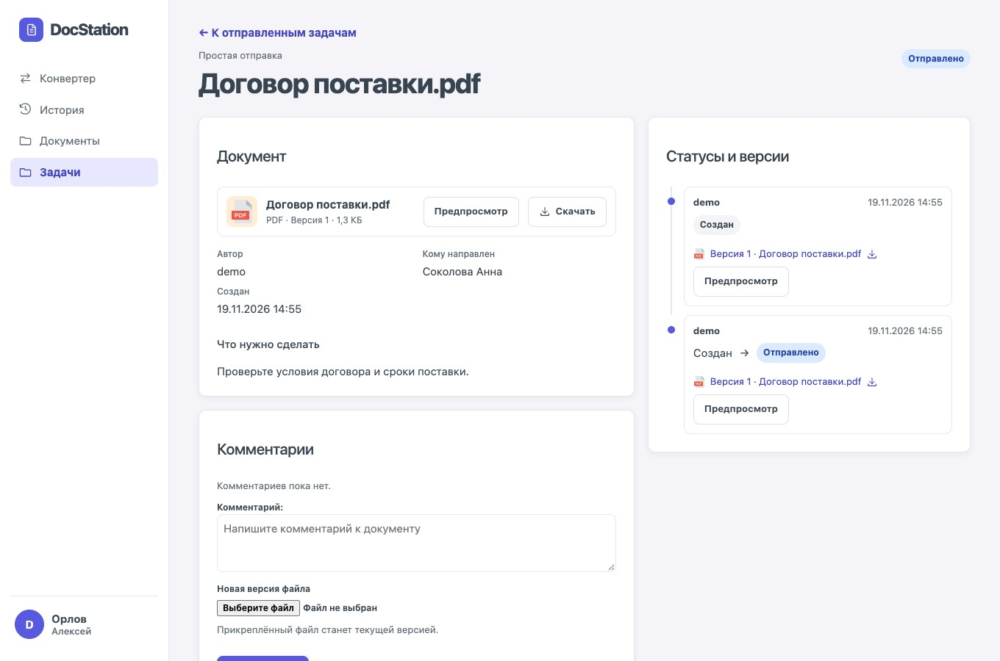

# Docstation

Docstation — веб-приложение для локальной конвертации файлов и хранения их версий. Пользователь загружает файлы через браузер, а отдельный процесс выполняет задачи в фоне. Каждый аккаунт видит собственные задания и результаты, а также доступные ему задачи.

Для экспорта сканов в Word обработчик использует локальный Tesseract с языками rus и eng. Остальные операции извлечения текста читают существующий текстовый слой.

## Скриншоты

### Конвертер документов



### PDF в Word с выбором языка распознавания



### Отправка документа из раздела «Задачи»



### Карточка отправленной задачи



## Системные требования

| Среда | Что понадобится |
| --- | --- |
| Локально с Docker | Docker Engine и Compose с поддержкой `up --wait`. На macOS можно использовать Colima |
| Сервер | Ubuntu 24.04 LTS, Docker Engine и Compose с поддержкой `!override` и `up --wait`. Серверная конфигурация проверялась с Compose 2.40.3 |
| Без Docker | Python 3.12, зависимости из `requirements.txt` и утилиты из раздела ниже |
| Клиент | Современный браузер с поддержкой JavaScript-модулей, для сетевого доступа — соединение с сервером |

Для небольшой установки можно начать с 2 vCPU, 4 ГБ ОЗУ и 30 ГБ SSD. Для регулярной обработки крупных PDF и офисных файлов ориентир — 4 vCPU, 8 ГБ ОЗУ и 60 ГБ SSD. Это оценки, а не измеренный минимум. Пачка предельного размера может содержать до 2,5 ГБ исходников. Учти место для результатов, временных файлов, резервных копий и роста архива.

## Запуск

После запуска открой [Docstation](http://127.0.0.1:8000/). Команды ниже выполняются из каталога проекта. Docker и локальный Python используют разные хранилища. У обоих вариантов порт `8000`, поэтому запускай их по очереди.

### Docker Compose

Понадобится работающий Docker Engine и Docker Compose с поддержкой `up --wait`. Если Docker на macOS настроен через Colima, сначала запусти `colima start`.

```sh
docker compose up --build --wait
```

При первом запуске создай аккаунт командой `docker compose exec web python manage.py createsuperuser` и войди на [странице входа](http://127.0.0.1:8000/login/). При следующих запусках достаточно `docker compose up --wait`. Повтори сборку после изменения исходников или зависимостей.

Compose поднимает два сервиса. `web` применяет миграции и запускает Django. `worker` начинает работу, когда `web` проходит проверку готовности. Порт опубликован на `127.0.0.1`. Первый билд скачивает базовый образ и зависимости, а при обработке файлов контейнер `worker` работает без доступа к сети.

```sh
docker compose ps
docker compose logs --tail=50 web worker
docker compose logs -f worker
docker compose stop
```

Остановка сохраняет том `archive`. Команда `docker compose down -v` удаляет том вместе с базой и файлами.

### Без Docker

Понадобятся Python 3.12 и инструменты, доступные через `PATH`.

| Инструмент | Команда | Назначение |
| --- | --- | --- |
| LibreOffice с Writer, Calc и Impress | `soffice` | Офисные преобразования и подготовка части офисных файлов для экспорта в Markdown |
| qpdf | `qpdf` | Объединение, разделение и извлечение страниц PDF |
| Ghostscript | `gs` | Сжатие PDF |
| Poppler | `pdftotext` | Извлечение текста из PDF с учётом расположения на странице |
| Tesseract OCR | `tesseract` и модели `rus`, `eng` | Распознавание сканов при экспорте в Word |
| Pandoc | `pandoc` | Markdown из офисных файлов и EPUB, сборка DOCX из содержимого PDF |

Список Python-зависимостей и их версии закреплены в [requirements.txt](requirements.txt). На машине с готовым окружением достаточно команды `./scripts/run-local.sh`. Для настройки с нуля создай окружение и установи зависимости.

```sh
python3.12 -m venv .venv
.venv/bin/python -m pip install -r requirements.txt
./scripts/run-local.sh
```

Скрипт применяет миграции и запускает веб-сервер и обработчик. При первом запуске создай аккаунт командой `.venv/bin/python manage.py createsuperuser` в другом терминале. `Ctrl+C` завершает оба процесса. Скрипт добавляет в `PATH` каталоги `.venv/bin` и `.venv/native-tools/env/bin`.

Чтобы запускать процессы по отдельности, сначала подготовь базу.

```sh
.venv/bin/python manage.py migrate
.venv/bin/python manage.py runserver 127.0.0.1:8000
```

Во втором терминале из каталога проекта запусти обработчик. Аргумент `--once` обрабатывает текущую очередь и завершает процесс, когда в ней больше нет задач.

```sh
.venv/bin/python manage.py worker
```

## Развёртывание на Ubuntu

Перенеси исходники проекта в отдельный каталог на сервере, например `~/docstation`. Для чистой установки нужны исходники, Dockerfile, файлы Compose и конфигурация Nginx. Локальный архив переносится отдельно через резервную копию.

Для первой установки создай `.env` рядом с файлами Compose. Замени `192.168.51.109` на адрес интерфейса своего сервера. Команда защищает существующий `.env` от перезаписи.

```sh
cd ~/docstation
(
  umask 077
  set -C
  {
    printf 'DOCSTATION_SECRET_KEY='
    openssl rand -hex 32
    printf '%s\n' 'DOCSTATION_HOSTS=localhost,127.0.0.1,192.168.51.109'
    printf '%s\n' 'DOCSTATION_PORT=8000'
  } > .env
)
```

Запусти из каталога проекта. Если для доступа к Docker на сервере требуется `sudo`, добавь его перед `docker`.

```sh
docker compose -f compose.yaml -f compose.server.yaml config -q
docker compose -f compose.yaml -f compose.server.yaml build --pull
docker compose -f compose.yaml -f compose.server.yaml up -d --wait
docker compose -f compose.yaml -f compose.server.yaml ps
```

На чистой установке создай административный аккаунт через консоль сервера. При обновлении действующие аккаунты и настройки регистрации сохраняются.

```sh
docker compose -f compose.yaml -f compose.server.yaml exec web python manage.py createsuperuser
```

Установи Nginx на хосте и настрой его по примеру [deploy/nginx.conf](deploy/nginx.conf). Укажи адрес сервера и пути к сертификату и ключу. Сертификат должен содержать IP-адрес в SAN и быть подписан центром сертификации, которому доверяют клиентские устройства. Для локальной сети подойдёт внутренний центр сертификации. Если изменишь `DOCSTATION_PORT`, поправь и порт в `proxy_pass`.

```sh
sudo nginx -t && sudo systemctl reload nginx
```

Открой `https://IP_СЕРВЕРА/`, войди и обработай тестовый файл. Django слушает только на loopback хоста, а Nginx передаёт признак HTTPS для защищённых cookie. Если вход или загрузка не работают, смотри журналы обоих сервисов.

```sh
docker compose -f compose.yaml -f compose.server.yaml logs --tail=80 web worker
```

Серверная конфигурация запускает Gunicorn с `DOCSTATION_DEBUG=0`. WhiteNoise отдаёт собранные при сборке стили и JavaScript. Контейнер обработчика работает без сети. При обновлении собери свежий образ с `--pull`, чтобы получить исправления системных пакетов. Скрипты, которые копируют только исходники поверх старого образа, не обновляют конвертеры.

При обновлении сделай резервную копию, перенеси новые исходники в тот же каталог и повтори `up -d --build --wait` с обоими файлами Compose. Оставь прежний `.env` и имя проекта Compose, чтобы использовать существующий том. Веб-сервис применяет миграции при запуске.

## Работа с файлами

1. В конвертере выбери инструмент и добавь файлы. Пачка вмещает до **50 файлов**, каждый размером до **50 МБ (50 000 000 байт)**.
2. Нажми **Запустить обработку**. Исходники сохраняются, а задачи отправляются в очередь.
3. В истории открой пачку и скачай отдельный результат или ZIP с готовыми результатами. Поддерживаемую операцию, завершившуюся ошибкой, можно повторить из карточки пачки.

На аккаунт выделено до 10 ГБ для исходников и результатов и до 100 ожидающих и выполняющихся задач. Результат одной задачи ограничен 500 МБ. При экспорте CSV строки, которые могут быть распознаны как формулы, получают префикс апострофа.

Обычная конвертация запускает отдельную задачу для каждого файла. Если часть файлов несовместима с операцией, для них появится ошибка, а остальные задачи продолжат обработку. Для **Объединить PDF** и **Фото в PDF** создаётся одна задача на пачку. В этих операциях важен порядок файлов. Его можно поменять стрелками рядом с именами.

В карточке обработки можно скачать исходник. Предпросмотр результатов доступен для PDF, JPEG, PNG, WebP и UTF-8 TXT.

## Задачи

В разделе «Задачи» нажми «Добавить», прикрепи файл, выбери адресата и укажи поручение. В карточке доступны статусы, комментарии, новые версии файла и возврат на переделку.

## Учётные записи

При открытой регистрации аккаунт можно создать со страницы входа. Панель управления и настройки регистрации доступны активным суперпользователям. В чистой установке регистрация закрыта. Управлять ею может суперпользователь, созданный через консоль.

Владелец может закрыть свободную регистрацию и выдавать одноразовые ссылки на 7 дней. Закрытие регистрации оставляет доступ через существующие аккаунты и действующие приглашения.
В панели **Управление** администратор создаёт и редактирует учётные записи, блокирует вход, сбрасывает пароли и назначает отделы. Группы обозначают отделы. Сотрудники одного отдела получают доступ только к своим и адресованным им карточкам.

- **Администратор** управляет учётными записями и отделами, видит все задачи и историю обработки файлов.
- **Сотрудник** отправляет и получает задачи, оставляет комментарии и прикладывает версии файла. Получатель меняет статус, а отправитель может вернуть готовую задачу на переделку.

Чтобы выдать права администратора существующему активному аккаунту, выполни на сервере после запуска новой версии:

```sh
docker compose -f compose.yaml -f compose.server.yaml exec web python manage.py grant_admin alex
```


## Форматы и операции

| Исходный формат | Результат |
| --- | --- |
| DOC, DOCX, ODT | DOCX, ODT или PDF |
| XLS, XLSX, ODS, CSV | XLSX, ODS, CSV или PDF |
| PPT, PPTX, ODP | PPTX, ODP или PDF |
| JPG, JPEG, PNG, WebP, TIFF, TIF, HEIC | JPG, PNG, WebP, TIFF или PDF |
| PDF | JPG, PNG или TXT через обычную конвертацию. DOCX и XLSX через отдельные инструменты |
| TXT, EPUB | Markdown ZIP |

В таблице указаны допустимые семейства. Выходной формат должен отличаться от входного. DOC, XLS, PPT и HEIC принимаются на вход. При экспорте XLSX в CSV используется активный лист. TXT и CSV нужно сохранять в UTF-8. BOM допускается.

### PDF

| Инструмент | Результат |
| --- | --- |
| Объединить PDF | Один PDF из двух или более файлов в заданном порядке |
| Разделить PDF | Отдельный PDF на каждую страницу. Несколько файлов упаковываются в ZIP |
| Извлечь страницы | Выбор страниц по миниатюрам. Результат можно скачать одним PDF или отдельными PDF. Лимит — 2000 выбранных страниц на документ |
| Сжать PDF | Степень сжатия от 0 до 100. После остановки ползунка показывается размер пробного результата для каждого файла. Если сжатый PDF оказался не меньше исходника, возвращается исходное содержимое |
| PDF в JPG или PNG | Изображение каждой страницы. Несколько изображений упаковываются в ZIP |
| PDF в TXT | Текст из существующего текстового слоя |
| PDF в Word | Редактируемый DOCX, собранный из доступного текста, обнаруженных таблиц и извлечённых изображений |
| Таблицы в Excel | XLSX с отдельными листами для обнаруженных таблиц текстового PDF |
| Фото в PDF | Один PDF из изображений в заданном порядке |

DOCX восстанавливает содержимое, а точность разметки зависит от структуры исходного PDF. Извлечение таблиц зависит от того, как строки и столбцы записаны в файле. В режиме «PDF в Word» можно выбрать русский или русский и английский языки OCR. Строки собираются в абзацы, русские переносы проверяются по словарю. Неоднозначные варианты указываются в конце документа для сверки. При экспорте в Word страницы без текста распознаются по отдельности. Если текст не найден, страница вставляется как изображение. В конце DOCX перечислены такие страницы и страницы с распознанным текстом. Скан внутри страницы, на которой уже есть цифровой текст, отдельно не распознаётся.

### Markdown

Инструмент **В Markdown** принимает все исходные форматы из таблицы. Результат — ZIP с `document.md` и, если есть извлечённые изображения, каталогом `images/`. Ссылки в Markdown относительные. Распакуй архив целиком, чтобы изображения открывались рядом с текстом.

CSV преобразуется в Markdown стандартным модулем Python `csv`. В PDF используются существующий текст, доступные таблицы и извлечённые изображения. При обработке отдельных изображений Markdown содержит ссылки на файлы из ZIP.

## Архитектура

Docstation использует Python 3.12, Django 5.2, SQLite, Django Templates и обычные HTML, CSS и JavaScript. Браузер получает правила допустимых форматов и лимиты от сервера. Файлы загружаются по одному, а сервер проверяет размер по мере записи. Пока задачи активны, браузер запрашивает только HTML-фрагмент со статусами.

| Модуль | Ответственность |
| --- | --- |
| [config/settings.py](config/settings.py) | Настройки Django, базы, авторизации, лимитов и каталогов |
| [documents/views.py](documents/views.py) и [documents/urls.py](documents/urls.py) | HTTP-маршруты, формы, ответы, скачивание и проверка доступа |
| [documents/operations.py](documents/operations.py) | Матрица форматов, параметры инструментов и проверка диапазонов страниц |
| [documents/uploads.py](documents/uploads.py) и [documents/version_storage.py](documents/version_storage.py) | Ограничение размера при загрузке и хранение исходников |
| [documents/jobs.py](documents/jobs.py) и [команда worker](documents/management/commands/worker.py) | Постановка задач, обработка, повтор и восстановление очереди |
| [documents/conversion.py](documents/conversion.py), [documents/structured.py](documents/structured.py) и [documents/spreadsheets.py](documents/spreadsheets.py) | Конвертация, извлечение содержимого PDF и работа с таблицами |
| [documents/workflow_views.py](documents/workflow_views.py) | Задачи, статусы и доступ получателей |
| [documents/auth_views.py](documents/auth_views.py) | Вход, регистрация и приглашения |
| [documents/file_responses.py](documents/file_responses.py) | Ответы для скачивания и предпросмотра |
| [documents/storage.py](documents/storage.py) | Хранилище файлов по UUID и упаковка ZIP |

Модель `Document` принадлежит пользователю. `Version` хранит номер версии, имя и ссылку на исходник. `Batch` группирует задачи, `JobInput` сохраняет порядок исходников для `Job`, а `Result` связывает итоговый файл с задачей. Исходники и результаты выдаются по маршрутам с проверкой владельца.

Обработчик выполняет задачи последовательно. Файловая блокировка разрешает один экземпляр обработчика на каталог данных. Состояния задачи идут от **В очереди** к **Обрабатывается**, затем к **Готово** или **Ошибка**. При старте обработчик возвращает прерванную задачу в очередь. Если обработка прервалась дважды, задача отмечается ошибкой и её можно повторить вручную. Повторная отправка уже принятой пачки возвращает ссылку на ту же пачку.

### Как подключить шаблон дашборда

Django собирает HTML на сервере, а JavaScript управляет загрузкой и обновлением статусов в браузере. Готовый HTML/CSS-шаблон можно адаптировать, сохранив серверную логику конвертации, задач и очереди. Для шаблона React или Vue понадобится отдельная интеграция. Он должен сам отрисовывать страницы и взаимодействовать с сервером, включая вход, CSRF-защиту и загрузку файлов.

1. Перенеси общую оболочку дашборда в `base.html`, а локальные стили и ассеты — в `documents/static/documents/`. Подключи ассеты через тег Django ``. Сохрани блоки `title`, `content` и `guest`. [Базовый шаблон](documents/templates/documents/base.html), [текущие стили](documents/static/documents/app.css)
2. Перенеси разметку отдельных страниц в соответствующие шаблоны. Для переходов и отправки форм используй существующие `` и ``. [Шаблоны страниц](documents/templates/documents/)
3. При переносе конвертера сверь идентификаторы, имена полей и атрибуты `data-*` с `app.js`. Скрипт использует `#converter`, `#conversion-form`, `#file-rules`, элементы загрузки и кнопки инструментов. CSS-классы оформления можно менять. В истории сохрани `#batch-results` и `data-poll`, чтобы обновление статусов продолжало работать. [Шаблон конвертера](documents/templates/documents/workspace.html), [фрагмент результатов](documents/templates/documents/batch_results.html), [JavaScript интерфейса](documents/static/documents/app.js)

После подключения шаблона проверь вход, загрузку файла, запуск обработки, обновление статусов и скачивание результата.

## Настройки и данные

| Переменная | Значение по умолчанию | Назначение |
| --- | --- | --- |
| `DOCSTATION_DATA` | `data/` в проекте. В Docker — `/data` | Каталог SQLite, файлов и временных данных |
| `DOCSTATION_DEBUG` | `1` | Режим разработки. Значение `0` выключает его |
| `DOCSTATION_SECRET_KEY` | В режиме разработки создаётся и сохраняется в `.secret` | Ключ Django. При `DOCSTATION_DEBUG=0` обязателен |
| `DOCSTATION_HOSTS` | `localhost,127.0.0.1,[::1]` | Список разрешённых имён хостов через запятую |
| `DOCSTATION_TIME_ZONE` | `Europe/Samara` | Часовой пояс приложения |

Данные локального запуска лежат в `data/`, а контейнеры используют именованный том `archive`. В обоих случаях структура одинаковая.

```text
archive.sqlite3   база, аккаунты, версии и очередь
.secret           локальный ключ Django, если создан автоматически
files/            оригиналы и результаты под именами UUID
uploads/          временные файлы при загрузке
work/             рабочие каталоги задач и блокировка обработчика
```

Для локального запуска используется `compose.yaml`. На сервере подключай также `compose.server.yaml`, как описано в разделе развёртывания. Секретный ключ храни в `.env` рядом с проектом и в защищённой резервной копии.

## Резервное копирование

Останови веб-сервер и обработчик перед копированием. База и каталог файлов должны попасть в одну копию, иначе записи архива могут ссылаться на отсутствующие документы. Храни копию как приватный файл, поскольку она содержит документы, аккаунты и, при наличии, локальный ключ Django.

### Docker

Создай архив тома из каталога проекта. Команда завершится ошибкой, если резервный файл уже существует.

```sh
docker compose stop &&
  (umask 077; set -C; docker compose run --rm --no-deps -T web tar -czf - -C /data . > docstation-backup.tar.gz) &&
  tar -tzf docstation-backup.tar.gz >/dev/null
```

Восстанови собственную копию в пустой том отдельного проекта `docstation-restored`. Исходный проект должен быть остановлен, чтобы освободить порт `8000`.

```sh
tar -tzf docstation-backup.tar.gz >/dev/null &&
  docker compose -p docstation-restored run --build --rm --no-deps -T web sh -ec '
    contents=$(ls -A /data)
    [ -z "$contents" ] || { echo "Том уже содержит данные." >&2; exit 1; }
    tar -xzf - -C /data
  ' < docstation-backup.tar.gz &&
  docker compose -p docstation-restored up --build --wait
```

Войди под прежним аккаунтом и скачай один исходник и один результат для проверки. В дальнейшем используй `docker compose -p docstation-restored up --wait` для запуска восстановленного проекта.

### Локальный Python

После остановки процессов создай архив. Если приложение запущено с другим `DOCSTATION_DATA`, укажи этот каталог вместо `data`.

```sh
(umask 077; set -C; tar -czf - -C data . > docstation-backup.tar.gz) &&
  tar -tzf docstation-backup.tar.gz >/dev/null
```

Распакуй собственную копию в новый каталог рядом с проектом, чтобы архив оставался вне каталога исходников.

```sh
restore_dir="$PWD/../docstation-restored-data"
mkdir -m 700 "$restore_dir" &&
  tar -xzf docstation-backup.tar.gz -C "$restore_dir" &&
  DOCSTATION_DATA="$restore_dir" ./scripts/run-local.sh
```

## Проверки и диагностика

Проверки выполняются из корня проекта. Тесты Django используют отдельную тестовую базу.

```sh
.venv/bin/python manage.py check
.venv/bin/python manage.py makemigrations --check --dry-run
.venv/bin/python manage.py test documents
.venv/bin/python -m pip check
docker compose config -q
```

Если контейнеры уже работают, тесты можно запустить командой `docker compose exec worker python manage.py test documents`.

| Симптом | Что проверить |
| --- | --- |
| Страница не открывается | Убедись, что запущен `web` и порт `8000` свободен. В Docker проверь `docker compose ps` и журнал `web` |
| Задачи остаются в очереди | Проверь, что запущен `worker`. При ручном запуске оба процесса должны использовать один `DOCSTATION_DATA` |
| `A worker is already running` | Для этого каталога уже занят lock. Используй существующий обработчик или останови его перед ручным запуском |
| Ошибка об отсутствующем инструменте | Проверь `command -v soffice qpdf gs pdftotext pandoc` в окружении обработчика |
| PDF не выгружается в TXT или DOCX | Проверь, выделяется ли текст в исходном PDF. Для сканов подходят операции над страницами |
| В Markdown не открываются картинки | Распакуй весь ZIP и сохрани `document.md` рядом с каталогом `images/` |
